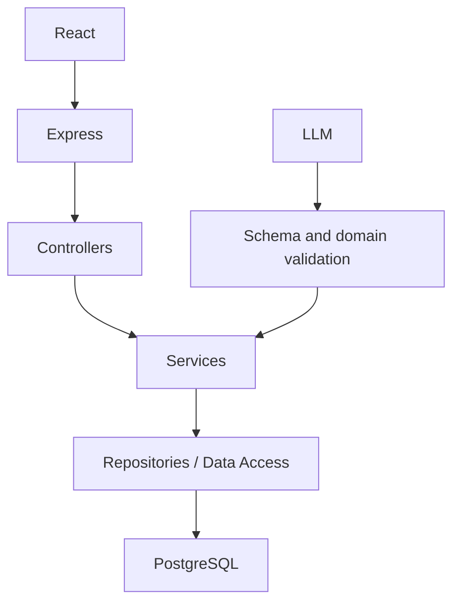

# RecallLoop

RecallLoop is an adaptive active-recall system. Learners study a topic, retrieve it from memory, receive rubric-based evaluation, and get deterministic review planning. The current foundation also includes authenticated goals, canonical knowledge, baseline assessment, learner state, resource recommendations, and focused remediation grounded in learner-provided sources.

## Setup

Requires Node.js 20+ and PostgreSQL 16+.

```bash
copy .env.example .env
docker compose up -d postgres
npm install
npm run db:migrate -w server
npm run dev
```

- UI: http://localhost:5173
- API: http://localhost:3001/api/health

## Environment

`DATABASE_URL` configures PostgreSQL. The defaults `LLM_PROVIDER=mock`, `EMBEDDING_PROVIDER=mock`, and `REMEDIATION_PROVIDER=mock` use deterministic local behavior without credentials. Run `npm run config:check -w server` to print active providers and warnings without printing keys.

The only LLM adapter currently implemented is OpenAI-compatible chat completions. To opt in, set `LLM_PROVIDER=openai-compatible`, `LLM_API_KEY`, `LLM_MODEL`, and `LLM_BASE_URL` in the untracked local `.env`. This adapter handles concept extraction and free-form answer evaluation; assessment questions still come from built-in deterministic blueprints and curated MCQs. `EMBEDDING_PROVIDER=openai-compatible` separately enables the OpenAI-compatible `/embeddings` API and requires `EMBEDDING_API_KEY`, `EMBEDDING_MODEL`, and `EMBEDDING_BASE_URL`. `REMEDIATION_PROVIDER=llm` uses the configured LLM to draft remediation from retrieved excerpts; `mock` keeps deterministic extractive remediation. A syntactically compatible endpoint/model is not proof of successful provider access; live calls need separate verification. Never put credentials in tracked files or frontend variables. See [.env.example](.env.example) and [Grounded Remediation](docs/GROUNDED_REMEDIATION.md).

## Commands

```bash
npm run dev
npm test
npm run test:e2e
npm run test:integration -w server
npm run build
npm run db:migrate -w server
npm run db:seed -w server
```

`npm test` runs database-independent unit tests. `npm run test:integration -w server` requires PostgreSQL and applies the relational integration checks.

`npm run test:e2e` starts isolated mock-provider API and Vite processes on ports 3101 and 5174, then drives Firefox through the learner journeys. It checks canonical roadmap rendering, rejected and valid study inputs with source URL separation, baseline duplicate/lost-response recovery and completion, a Rapid Fire round with progressive hints and its assessment report, and grounded remediation citation rendering plus targeted verification. It requires Firefox and the local `recallloop` PostgreSQL database with migrations and seed data applied; the script creates and deletes one uniquely named E2E learner account and stops its child processes.

## Architecture



Controllers remain thin. Domain services own business rules. PostgreSQL owns durable state. Optional LLM providers produce structured extraction, evaluation, and grounded-remediation candidates; validated domain services own persistence, ownership, scheduling, and transactions.

## Product flow

`Goal -> Canonical Knowledge -> Baseline -> Learner Model -> Planner -> Study -> Recall -> Evaluation -> Learner Model -> Plan update`

- `/goals` manages learner goals.
- `/knowledge` browses curated role and skill requirements.
- Goal detail supports new, familiar, advanced, and Trust Me starting paths.
- `/baseline/:id/result` shows observed versus self-declared knowledge and focused resources.
- `/plan/today` shows deterministic work and reasons.
- `/learner` shows personal learner signals.
- Focused Resources accepts user-provided text or Markdown for source-grounded remediation; it does not fetch the supplied reference URL. Local embedding and remediation providers are deterministic and require no API credential.

## Documentation

- [Documentation index](docs/README.md)
- [docs/ARCHITECTURE.md](docs/ARCHITECTURE.md)
- [docs/FLOW.md](docs/FLOW.md)
- [docs/DATA_MODEL.md](docs/DATA_MODEL.md)
- [docs/PROJECT_STATUS.md](docs/PROJECT_STATUS.md)
- [docs/LEARNING_MODEL.md](docs/LEARNING_MODEL.md)
- [docs/POSTGRES_RUNTIME_MIGRATION_STATUS.md](docs/POSTGRES_RUNTIME_MIGRATION_STATUS.md)
- [docs/POSTGRES_CUTOVER_REPORT.md](docs/POSTGRES_CUTOVER_REPORT.md)
- [docs/POSTGRES_CUTOVER_AUDIT.md](docs/POSTGRES_CUTOVER_AUDIT.md)
