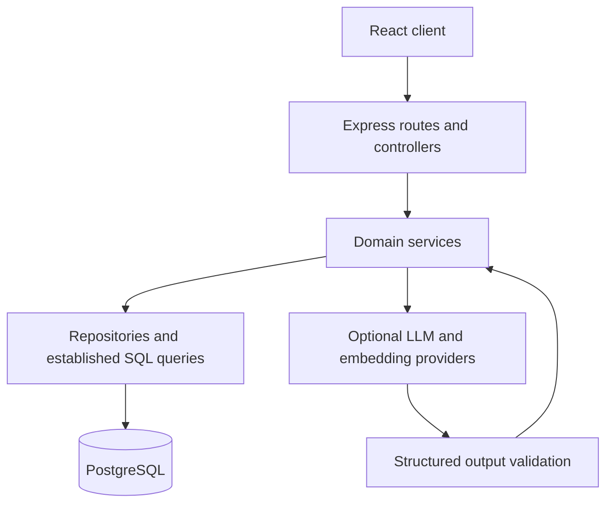

# RecallLoop

RecallLoop is an active-recall learning app. Learners study material, answer questions, receive evidence-linked feedback, and use deterministic review planning. This README describes functionality present in this repository; it does not describe a deployed service or claim that every planned feature is complete.

## What is in this repository

| Path | Contents |
|---|---|
| `client/` | React/Vite learner application, pages, shared UI, styles, API client, and browser E2E tests. |
| `server/` | Express API, request controllers/routes, domain services, repositories, PostgreSQL access, scripts, unit tests, and additive SQL migrations. |
| `server/migrations/` | Ordered database schema and data migrations. Apply them with the command below; API startup does not migrate automatically. |
| `scripts/` | Local assessment-loop and question-review workflow scripts. |
| `docs/` | Architecture, data model, API flows, UX journey, roadmap, project status, question-bank review, and grounding documentation. Start at [docs/README.md](docs/README.md). |
| `docker-compose.yml` | Local PostgreSQL service. |

## Current functionality

- Account-authenticated goals, learner knowledge, study sessions, recall attempts, answer evaluation, and review scheduling.
- Canonical role/skill/topic/concept roadmaps, baseline assessments, readiness evidence, daily plans, and resource recommendations.
- Deterministic built-in assessment blueprints and curated question content. LLMs do not generate the canonical assessment bank.
- A revisioned canonical question bank with exact point mappings and an authorized human-review/publication gate. The Core SDE authoring set currently contains 114 candidates over 19 knowledge points in Data Structures and Algorithms, Operating Systems, Database Management Systems, Computer Networks, and System Design. These new candidates are drafts; normal learners cannot use them until eligible exact revisions are independently reviewed and published. See [question-bank status](docs/CANONICAL_QUESTION_BANK.md).
- Focused grounded remediation: learners can add text or Markdown they are allowed to use, and RecallLoop can retrieve relevant excerpts, show their source attribution, and offer targeted verification. RecallLoop does not fetch the supplied reference URL.

## Current RAG scope

Retrieval-augmented generation is implemented for learner-provided text/Markdown and weak knowledge points. The current flow normalizes and chunks text, embeds chunks, retrieves relevant learner-owned excerpts, applies a relevance threshold, and passes retrieved evidence to a validated remediation generator. Local defaults are deterministic. An OpenAI-compatible embedding provider and optional LLM remediation generator are available by explicit configuration.

Current limits: no URL fetching or PDF/document parsing; PostgreSQL `real[]` vectors are ranked in application code using cosine similarity plus token overlap; pgvector and indexed vector search are not in use. See [Grounded Remediation](docs/GROUNDED_REMEDIATION.md) for data flow, configuration, limits, and tests.

## Tech stack

- **Workspace/runtime:** npm workspaces, Node.js 20+, TypeScript.
- **Client:** React 19, Vite 6, React Router 7, Motion, and Lucide.
- **Server:** Express 4, Zod, JWT, bcryptjs, and `pg`.
- **Persistence:** PostgreSQL 16 with SQL migrations; the server does not use an ORM.
- **Tests:** Vitest and Supertest; Selenium WebDriver/Firefox and Playwright/Edge for browser coverage.

## Setup

Requires Node.js 20+, npm, and PostgreSQL 16. Docker Compose provides PostgreSQL locally.

```bash
cp .env.example .env
npm install
docker compose up -d postgres
npm run db:migrate -w server
npm run db:seed -w server
npm run dev
```

On Windows PowerShell, use `Copy-Item .env.example .env` for the first command. Configure `DATABASE_URL` in the local, untracked `.env` if you are not using the compose defaults.

- Client: http://localhost:5173
- API health endpoint: http://localhost:3001/api/health

## Provider configuration

Default `LLM_PROVIDER=mock`, `EMBEDDING_PROVIDER=mock`, and `REMEDIATION_PROVIDER=mock` use deterministic local behavior without provider credentials. `npm run config:check -w server` prints provider selection and safe configuration diagnostics without printing keys.

The implemented remote adapters use OpenAI-compatible APIs. Set `LLM_PROVIDER=openai-compatible` with `LLM_API_KEY`, `LLM_MODEL`, and `LLM_BASE_URL` for concept extraction and free-form answer evaluation. Set `EMBEDDING_PROVIDER=openai-compatible` with `EMBEDDING_API_KEY`, `EMBEDDING_MODEL`, and `EMBEDDING_BASE_URL` for embeddings. Set `REMEDIATION_PROVIDER=llm` to use the configured LLM for grounded remediation; otherwise deterministic extractive remediation is used. Provider configuration does not guarantee endpoint availability or content quality. Never put credentials in tracked files or frontend variables. See [.env.example](.env.example) and [Grounded Remediation](docs/GROUNDED_REMEDIATION.md).

## Commands

```bash
npm run dev
npm test
npm run build
npm run test:integration -w server
npm run test:e2e
npm run test:assessment-loop
npm run db:migrate -w server
npm run db:seed -w server
npm run question-bank:coverage
```

- `npm test` runs server unit tests and does not require PostgreSQL.
- `npm run build` type-checks/builds both workspaces.
- `npm run test:integration -w server` requires a migrated, seeded PostgreSQL database.
- `npm run test:e2e` runs browser journeys against the configured local database and requires the supported browsers.
- `npm run test:assessment-loop` creates a disposable database on loopback PostgreSQL, runs integration and browser coverage with test-only review fixtures, then removes that database. It requires local database `CREATEDB` permission and the browser dependencies.
- `npm run question-bank:coverage` creates a database-grounded Core SDE coverage snapshot. Run after migrations and seed; the checked-in JSON is a snapshot, not a live report.

## Planned or not yet present

- Genuine independent subject-matter review and publication of the new Core SDE questions.
- PDF parsing, URL ingestion, pgvector, and indexed semantic search.
- Within-concept selection of an individual knowledge point in the assessment UI.
- Retrieval-quality benchmarks with human-labeled relevance and broader evaluation of learner outcomes.

The [project status](docs/PROJECT_STATUS.md) tracks implementation and verification evidence. The [core learning roadmap](docs/CORE_LEARNING_ROADMAP.md) tracks follow-on work. Do not treat a roadmap item or a test fixture approval as a shipped feature or human review decision.

## Architecture



Controllers parse requests and delegate domain decisions to services. PostgreSQL stores durable learner and catalog state. Some services use the established database query module directly rather than a repository wrapper. Provider output remains untrusted until it passes validation.

## Main learner routes

- `/goals` — manage learning goals.
- `/knowledge` — browse curated canonical knowledge.
- `/knowledge-check` — select from current canonical catalog coverage and see whether approved assessment coverage is available.
- Goal detail — choose a new, familiar, advanced, or guided starting path.
- `/baseline/:id/result` — view observed baseline evidence and focused resources.
- `/plan/today` — follow deterministic daily tasks and their stated reasons.
- `/learner` and `/readiness` — review learner signals and submitted evidence.
- Focused Resources — add learner-provided text/Markdown and access grounded remediation when relevant evidence and source material exist.

## Further documentation

- [Documentation index](docs/README.md)
- [Architecture](docs/ARCHITECTURE.md)
- [Request and function flows](docs/FLOW.md)
- [Data model](docs/DATA_MODEL.md)
- [Project status](docs/PROJECT_STATUS.md)
- [UX journey](docs/UX_JOURNEY.md)
- [Core learning roadmap](docs/CORE_LEARNING_ROADMAP.md)
- [Canonical question bank](docs/CANONICAL_QUESTION_BANK.md)
- [Question bank review workflow](docs/QUESTION_BANK_REVIEW.md)
- [Grounded remediation](docs/GROUNDED_REMEDIATION.md)
