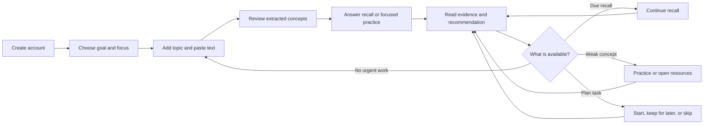

# Product flow and UX journey audit

**Audit date:** 2026-10-19  
**Scope:** First visit, study setup, practice and evidence, weakness follow-up, returning home, goals/readiness, daily plan, knowledge map, resources, and settings.  
**Evidence rule:** This document describes routes and actions observed in the current React client and server call paths. API-owned outcomes remain authoritative. Where the implementation has no state or contract to support a proposed handoff, that limit is called out.

## Intended learner journey

### State-aware Home

Home chooses one primary action from persisted data, in this order: a first goal for a learner with no saved goal or study history; a due recall; an in-progress study session; the first planned/in-progress task; a weak concept practice action; otherwise a new study session for an active goal. A due recall links to its existing attempt. A weak concept requests a practice assessment; if the approved question bank cannot support it, the learner sees the reason and a link to focused resources. First-visit Home hides the goal/plan/evidence summary cards so the setup action stays clear.

The user’s conceptual stages are not all represented by server state. In particular, there is no dashboard signal for a pending remediation verification attempt separate from its recall attempt. The current reliable Home signal is due recall. Verification remains linked from the remediation and result screens.

## Navigation and page roles

| Navigation entry | Route | Learner question it answers |
|---|---|---|
| Dashboard / Home | `/dashboard` | What is the most useful available next step? |
| New study | `/study/new` | What topic and source text should I study? |
| Today’s plan | `/plan/today` | What steps are planned, and what is their status? |
| Goals | `/goals` | Which outcomes organize my learning? |
| Knowledge | `/knowledge` | What is in the curated role/skill/topic/concept map? |
| Resources | `/resources` | What material is available for a topic or gap? |
| Learner | `/learner` | What do my submitted personal-concept recalls show? |
| Settings | `/settings` | How should scheduled reviews be handled? |

`My Learner` and goal-scoped `My Readiness` remain distinct. Learner is a rolling signal over a user’s personal concepts and recall mistakes. Readiness is the latest submitted point-level evidence for canonical skills attached to a particular goal, with mapped/unmapped and no-evidence states. The latter is reached through a goal and does not claim an aggregate skill score.

## Action inventory

“Failure” below means the visible recovery path for the action; the exact error text can vary by API error class. Form data remains in the page when a request fails unless the action succeeds.

| Page / control | Handler and destination | Expected result | Failure / recovery | Role / evidence |
|---|---|---|---|---|
| Landing: Create account / Sign in | React Router → `/register` or `/login`; auth API | Authenticated workspace opens | Form validation and API alert; retry or correct fields | First-time, returning; browser E2E |
| Onboarding: goal, schedule, focus, starting point | `api.createGoal`, optional `api.createSkill`, optional baseline API; then `/study/new?...` or `/baseline/:id` | Saves a goal and opens the next setup step | Duplicate title offers existing goals; saved-goal partial failure links to that goal | First-time; browser E2E covers goal/focus→study |
| Home: primary action | Dashboard selector; `/goals/new`, `/recall/:id`, `/study/:id`, `/plan/today`, `/assessments/:id`, or `/study/new` | Opens the first supported next step | Targeted practice errors explain bank coverage and link to `/resources?conceptId=…`; data load error has retry/sign-in | All learner states; browser E2E covers first visit and due recall |
| New study: topic suggestion | Combobox state; selects mapped topic/concept IDs | Prefills the chosen catalog label and mapping | User can edit or enter a custom topic | Any learner; E2E checks catalog handoff |
| New study: source type, URL, notes, Create study session | `onSubmit` → `api.createStudySession`; `/study/:id` | Persists pasted text and separate URL provenance, then shows extracted concepts | Validation explains that URL-only input is insufficient; provider/unknown failure preserves fields and blocks unsafe duplicate retry | First study; E2E covers invalid inputs, saved source URL, and creation |
| Study session: practice-mode disclosure and mode buttons | `api.createAssessment(conceptId, mode)` → `/assessments/:id` | Starts Rapid Fire, deep recall, or mastery check | Inline alert; keep the concept page available | Practice; browser E2E covers Rapid Fire |
| Study session: Finish review and start recall | `api.completeStudySession` → `/recall/:id` | Marks the session complete and opens its first recall | Inline alert and retry | Practice; existing browser E2E covers study creation and recall handoffs |
| Recall: submit answer / reveal hint | `api.submitRecall` / `api.revealRecallHint`; result route after submission | Saves evaluated evidence or reveals a hint | Re-fetches submission state after uncertain response; preserves an unsaved answer and reports next step | Practice; E2E covers a submitted recall and remediation verification |
| Assessment: submit, hint, recommendation | `api.submitRecall`, `api.revealRecallHint`, recommendation-specific route | Shows score/point coverage and opens the named follow-up | Inline status alert; focused practice, review, resources, and understanding checks use specific action labels | Practice; E2E checks completed Rapid Fire report |
| Recall result: date preference / recommendation | `api.confirmReviewDate`; recommendation dispatches remediation, resources, or assessment | Shows submitted evidence, review timing, and the actual follow-up destination | Save/start errors are shown beside the action | Returning; browser E2E verifies grounded remediation and verification |
| Goals: open/create | `/goals/:id`, `/goals/new`; `api.createGoal` | Opens goal detail or persists a new goal | Duplicate response links to existing goals; other failure permits correction/retry | Goal management; browser E2E creates supporting goals |
| Goal detail: baseline, skip baseline, skill form, plan/readiness links | Baseline and skill APIs; `/baseline/:id`, `/plan/today?goalId=…`, `/goals/:id/readiness` | Starts a baseline or explicitly skips it; then opens goal plan/evidence | Error stays with form; skip is labeled as producing no starting evidence | Goal management; baseline/readiness E2E |
| Today’s plan: Start step / Start recall / Study this topic / Open focused resources | Marks task `in_progress`, then opens the linked recall, starts the matching assessment, opens the focused resource list for remediation, or opens a prefilled study setup for a goal-level Learn task. Study and recall routes carry an allow-listed `/plan/today` return destination. | Starts the task type the plan displays; return links lead back to the plan | A failed status update does not navigate or create an assessment; a failed activity stays on the plan with an error | Daily practice; browser E2E covers due recall and skill-level Learn handoff |
| Today’s plan: Mark complete | `api.updatePlanTask(taskId, "completed")` | Marks only this task complete | Status remains visible and update error appears at top | Daily practice; browser E2E checks persistence |
| Today’s plan: Keep for later today | `api.updatePlanTask(taskId, "in_progress")` | Keeps task on today’s plan and marks it in progress | Update error appears; task state remains unchanged | Daily practice; browser E2E checks persisted `in_progress` |
| Today’s plan: Skip today | `api.updatePlanTask(taskId, "missed")` | Removes task from the “up next” selection and marks it skipped today | Task remains visible with “Skipped for today”; can be put back in today’s plan | Daily practice; browser E2E checks persisted `missed` |
| Knowledge: role/topic/concept links | Read APIs; study-new URL carries canonical IDs; topic/skill anchor links remain | Explores persisted catalog or opens a pre-mapped study setup | Empty/error states retain a route back to study or catalog | Exploration; browser E2E checks exact concept mapping |
| Resources: refresh, external resource, contribute notes | Recommendation/learning-pack APIs; external URL; `api.ingestGroundingSource` | Shows related resources or stores text for grounded remediation | Load/save errors and success notice use live status semantics; no source is presented as usable before server reports ready | Resource and remediation; browser E2E checks recommendations/citations |
| Learner: Practice this concept / View resources | `api.createAssessment(conceptId, "practice")` or `/resources?conceptId=…` | Starts targeted practice or opens explicit supporting resources | If bank review/coverage blocks assessment, the learner gets a reason and resource fallback | Weakness follow-up; browser E2E checks action on a weak custom concept |
| My Readiness: goal evidence view | `api.goalReadiness(goalId)`; goal-scoped route | Separates correct/partial/incorrect/unanswered/latest and no evidence | Unmapped skills are visibly marked not assessed; no unsupported score is inferred | Goal review; browser E2E checks mapped and unmapped states |
| Settings: save review mode | Settings API | Persists automatic/confirm/manual review handling | Inline error and retained selection | Returning; no dedicated E2E assertion in this run |
| Remediation: check what you remember | Grounded remediation API creates verification attempt → `/recall/:id` | Uses the targeted knowledge point to create follow-up evidence | Insufficient source/generation state is explained with fallback resources | Weakness recovery; browser E2E checks source attribution and improvement |

## Audit findings and changes

The following ten confusing or unreliable actions were observed before this pass. Severity describes learner impact, not code risk.

| # | Severity and observed issue | Current behavior that caused confusion | Change in this pass | Verification |
|---|---|---|---|---|
| 1 | High — Home had one due-recall branch and a generic study empty state | New learners saw study as the first action, and active/in-progress work did not determine the hero | Added state-aware Home priorities using existing goal, due, session, plan, and learner APIs | Browser assertion for first-visit goal and returning due recall; exact viewport smoke |
| 2 | High — first-visit Home showed several competing empty cards | Goal, plan, recall, and study entry points all competed before the first action | First visit now has one goal action and knowledge-map secondary link; summary cards wait until the learner has history | Screenshot `home-1440.png` / `home-390.png`; E2E text assertion |
| 3 | High — source controls implied a browser fetch or file upload | URL and file source labels sat beside pasted text even though the server uses only pasted text | Renamed source options and stated that links are provenance and files are not uploaded/fetched | E2E source persistence and URL-only rejection; screenshot of study setup |
| 4 | Medium — “Continue to study” obscured what happened next | It created a session with extracted concepts rather than immediately starting recall | Renamed to “Create study session” and placed a three-step review/recall sequence before the form | First-journey browser flow and study setup screenshot |
| 5 | Medium — each extracted concept exposed three equal practice buttons | Alternative modes competed with the session-level finish-and-recall action | Collapsed alternatives under “Choose a practice mode”; renamed the session action to “Finish review and start recall” | Rapid Fire E2E selector and browser flow |
| 6 | High — baseline checkbox and CTA did not explain the effect of skipping | “Trust me” and “Choose starting point” hid whether a baseline would exist | Renamed to “Skip the baseline assessment,” stated the no-evidence consequence, and changed the CTA by state | Browser asserts both CTA states and the no-evidence consequence; baseline assessment E2E passed |
| 7 | High — plan “Done for now” implied defer, async failures could still navigate, and goal-level Learn tasks had no start action | Completion, skip, and defer were not distinct; task writes were swallowed before navigation; a generated Learn task had no concept ID, so no start control appeared | Added Mark complete, Keep for later today, Skip today, explicit status chips, awaited updates before navigation, and a plan-to-prefilled-study handoff for Learn tasks. Remediation tasks open focused resources. | Browser E2E exercises all three persisted statuses, the skill-level Learn handoff, and recall return |
| 8 | High — a weak-concept row opened resources only | The learner had no direct action for focused practice | Added Practice this concept and kept View resources as explicit fallback; bank-gate failures are explained | Browser E2E starts practice from a weak custom concept |
| 9 | Medium — a plan-started assessment or recall exited to Home | Assessment/recall pages discarded the plan’s context | Added allow-listed `/plan/today` return context through recall/result and assessment pages | Browser E2E starts the scheduled recall and returns to plan |
| 10 | Medium — result recommendation button always said “Practice now” | The actual destination could be resources, remediation, mastery check, or another recall mode | Button text now names the actual next action; Learner and My Readiness page roles are documented separately | Existing assessment and remediation E2E; text/action inventory |

## Four end-to-end learner paths

| Journey | Browser steps | API/persistence evidence | Automated coverage |
|---|---|---|---|
| 1. New learner begins study | Register → first-visit Home → onboarding goal/focus → add text → study session with concepts | Authenticated session lookup confirms the created study session exists; earlier E2E also asserts source URL and raw text persistence | `knowledge-roadmap.mjs` onboarding and setup path; Playwright Home/study screenshots |
| 2. Weakness to evidence-based follow-up | Submit wrong answer → Learner → practice this concept → add cited grounding notes → focused remediation → answer verification | Triggering attempt is incorrect; source reference is preserved; remediation becomes verified and reports improvement | Firefox Selenium end-to-end path; custom-concept practice action included |
| 3. Returning learner’s next action | Persist a due review state for a pending recall → Home → start recall | Home primary `href` matches the pending attempt; submitted recall produces result | Firefox Selenium Home assertion; Playwright exact viewport layout checks |
| 4. Daily plan task | Generate plan → start scheduled recall → submit → return to plan → open a prefilled topic for a goal-level Learn task → return → mark complete; defer another task, then skip it | PostgreSQL verifies `completed`, `in_progress`, and `missed`; separate overdue fixture verifies UTC-day transition | Firefox Selenium UI path; due/overdue dates use isolated test data |

The E2E harness uses a disposable learner, deterministic mock providers, and a loopback-only local database. It writes a due timestamp and an overdue scheduled timestamp as test fixtures because waiting for a real due date or crossing UTC midnight is not practical. The task actions themselves are exercised through the browser and their final persisted state is checked. The historical URL-title compatibility check updates only the test learner’s disposable session to construct legacy data.

## Browser, responsive, and accessibility checks

The host Firefox window manager clamps a requested 390 CSS-pixel viewport to 450 pixels. To meet the exact viewport requirement, the E2E script now also runs the installed Edge browser through Playwright. It checks Home at 1440×900, 768×1024, and 390×844, asserts exact `innerWidth`/`innerHeight` and no horizontal document overflow, and captures the new Home, study setup, and empty-plan views. Firefox continues to cover the interactive end-to-end journeys.

Automated checks cover named buttons, links, labeled form controls, live errors, keyboard-operable native disclosures, and explicit status labels. Screenshots were visually inspected. A full keyboard/focus audit and WCAG conformance review were not performed.

## Known product limits

- File content is not uploaded or extracted from a URL. The learner must paste the text; the optional URL is provenance.
- Curated canonical assessment creation remains gated by revision-level human approval and coverage. A weak canonical point can therefore show a practice gate and route to available resources.
- “Keep for later today” stores `in_progress`; it does not schedule a new date. Prior-day in-progress tasks can be marked missed by the existing daily-plan lifecycle.
- The current dashboard API does not expose an independent verification-available state. Verification is started from the remediation or result page.
- Review mode save, login/register validation, and settings remain without dedicated browser assertions in this suite.

