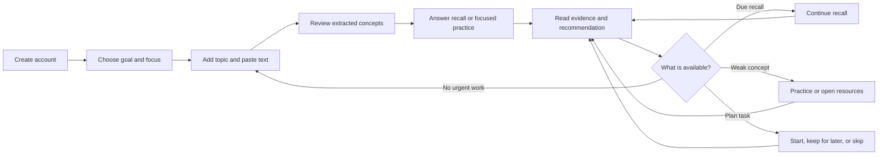

# Product flow and UX journey audit

**Audit date:** 2026-10-19  
**Scope:** First visit, study setup, practice and evidence, weakness follow-up, returning home, goals/readiness, daily plan, knowledge map, resources, and settings.  
**Evidence rule:** This document describes routes and actions observed in the current React client and server call paths. API-owned outcomes remain authoritative. Where the implementation has no state or contract to support a proposed handoff, that limit is called out.

## Current learner intent journey

Home at `/dashboard` always presents three options: Test my knowledge, Learn something new, and Review and improve. Test is visually primary; Learn and Review remain equally reachable as secondary entry points. A separate continuation strip uses available due review, unfinished session, planned task, evidence-backed weakness, or active goal context. First-time learners see none of the empty metric warnings.

### Test my knowledge

`/dashboard` → `/knowledge-check` → choose a canonical skill subject, topic, and one canonical concept → choose an eligible fixed assessment mode → `/assessments/:id` → question-level report and next action. The authenticated `GET /api/assessments/coverage` response is backed by active canonical catalog nodes and current published, quality-valid, exact-revision approved question revisions. Supported modes match `assessmentBlueprint`: Rapid Fire requires 2 MCQ and 3 rapid recall questions; Deep Recall requires 1 descriptive question; Practice requires 1 scenario; Mastery Check requires 1 each of MCQ, rapid recall, short explanation, scenario, descriptive, and transfer. Modes and coverage counts are shown only when those complete blueprints are available. The service rechecks coverage and creates the assessment in one transaction. Cross-topic combined assessments and whole-subject assessments are not supported by the current engine.

For a supported canonical check, the transaction creates a completed no-material session as the existing recall schema's evidence parent, a user-owned canonical-mapped personal concept, the assessment, learner-scoped question snapshots, and attempts. A failed coverage check creates none of these records. Existing owner checks, deterministic MCQ grading, validated free-response grading, duplicate submission guards, and exact canonical revision links remain in use. Submitted reports show the learner's answer, actual outcome, point feedback and post-submit explanation/rubric reasoning; weak points link to focused resources and subsequent assessment uses the existing recommendation path.

**Current bank limitation:** The configured PostgreSQL database has 24 current HTTP pilot revisions awaiting subject-matter approval and zero approvals. Those concepts do not offer canonical assessment modes until enough approved questions form a complete blueprint. The UI presents this limitation and offers the Learn flow; it does not silently switch to generated questions. The database-grounded [HTTP Rapid Fire reviewer packet](question-bank/http-rapid-fire-review-packet.json) contains the smallest useful single-concept assessment set (two MCQ and three rapid-recall revisions) plus one distinct point-mapped follow-up verification revision, with exact IDs/hashes, mappings, expected answers, rubrics, source provenance, and blank independent-review fields. It does not grant eligibility.

### Learn something new

`/dashboard` → `/study/new` → choose whether the material is new, previously studied but not confidently remembered, or intended for application → enter a topic and required pasted text (optionally save an HTTP(S) link as provenance) → `POST /api/study-sessions` extracts and persists concepts → `/study/:id?intent=…` confirms the session and exposes recall/practice. URL content is not fetched and files are not uploaded. The intent affects session guidance and opens the existing practice disclosure for application; it does not change extraction or grading behavior.

Study-session APIs are authenticated and owner-scoped; opening `/api/study-sessions` directly without a bearer token correctly returns `401 UNAUTHORIZED`. If creation returns `401`, the UI identifies a missing or expired sign-in as a definitive rejection, preserves the topic and notes, and permits retry after signing in. Other failed writes retain the conservative ambiguous-outcome message.

### Review and improve

`/dashboard` → `/review` lists due recalls from scheduler state, weak concepts from submitted learner evidence, unfinished study sessions, and planned/in-progress plan tasks. Due work links to `/recall/:id?returnTo=/review`; weak concepts offer supported practice with a resource fallback; unfinished sessions resume at `/study/:id`; planner tasks remain in `/plan/today`. The page explains due status from the existing schedule and weakness from submitted missed-point evidence. It does not invent dates or treat unassessed concepts as weak. Its empty state links to Test or Learn.

### My Readiness

`/dashboard` -> `/readiness` is directly reachable from Home and primary navigation. Learners can select one of their existing goals; the page reads the existing authenticated `GET /api/goals/:goalId/readiness` projection. When there is no goal, it explains that the established readiness model is goal-scoped and offers goal setup without blocking access to the page. For each goal focus skill it shows canonical mapping state, latest submitted point outcomes (demonstrated, partial, incorrect, unanswered), unassessed points, and evidence recency. It links to study, Review & Improve, and the canonical knowledge map. It makes no confidence, mastery percentage, or aggregate readiness score.

My Readiness explains what available evidence says. Review & Improve is the action queue for due reviews, submitted weaknesses, unfinished sessions, and plan tasks. The two pages use the same persisted learner state for different jobs.

### Returning learner flexibility and utilities

A due recall or another existing task can supply the contextual continuation without hiding the three Home intents. Goals, canonical knowledge maps, resources, today's plan, learner evidence, My Readiness, and settings remain accessible through navigation and utility links. Plan complete, keep-for-later (`in_progress`), and skip (`missed`) states remain distinct. Report/remediation paths preserve safe local return routes.

## Phase U1 acceptance checklist (2026-10-19)

- [x] Test a Topic: learners select live canonical subjects/topics/concepts without a roadmap prerequisite; assessment modes require a complete exact-approved blueprint.
- [x] Learn from My Material: notes-first existing study flow carries the selected new/remember/apply intent.
- [x] Review & Improve: due scheduler work, submitted weakness, unfinished sessions, and plan tasks use existing action routes and state transitions.
- [x] My Readiness: reachable directly from Home and primary navigation before a goal exists; an existing goal selection exposes persisted outcome states and evidence recency.
- [x] Verify empty/unassessed and submitted partial evidence, direct entry, and distinction between evidence explanation and action queue in Firefox.
- [ ] Activate the live canonical HTTP assessment-to-verification journey: blocked by human review. The live database-grounded packet is at [HTTP Rapid Fire reviewer packet](question-bank/http-rapid-fire-review-packet.json); five exact current revisions enable Rapid Fire and a sixth distinct revision enables verification. All six await authorized SME review.

## Previous flow audit snapshot (superseded by learner-intent flow below)

### Previous State-aware Home snapshot (superseded)

Home chooses one primary action from persisted data, in this order: a first goal for a learner with no saved goal or study history; a due recall; an in-progress study session; the first planned/in-progress task; a weak concept practice action; otherwise a new study session for an active goal. A due recall links to its existing attempt. A weak concept requests a practice assessment; if the approved question bank cannot support it, the learner sees the reason and a link to focused resources. First-visit Home hides the goal/plan/evidence summary cards so the setup action stays clear.

The user’s conceptual stages are not all represented by server state. In particular, there is no dashboard signal for a pending remediation verification attempt separate from its recall attempt. The current reliable Home signal is due recall. Verification remains linked from the remediation and result screens.

## Navigation and page roles

| Navigation entry | Route | Learner question it answers |
|---|---|---|
| Dashboard / Home | `/dashboard` | Which learning intention should I choose, and what useful task can continue? |
| Test my knowledge | `/knowledge-check` | Which canonical topic and assessment can I actually test? |
| Learn | `/study/new` | What topic and supplied text should I study? |
| Review and improve | `/review` | What is due, unfinished, or weak based on my evidence? |
| My Readiness | `/readiness` | What does my submitted evidence show for this goal's focus skills? |
| Today’s plan | `/plan/today` | What steps are planned, and what is their status? |
| Goals | `/goals` | Which outcomes organize my learning? |
| Knowledge | `/knowledge` | What is in the curated role/skill/topic/concept map? |
| Resources | `/resources` | What material is available for a topic or gap? |
| Learner | `/learner` | What do my submitted personal-concept recalls show? |
| Settings | `/settings` | How should scheduled reviews be handled? |

`My Learner` and `My Readiness` remain distinct. Learner is a rolling signal over a user's personal concepts and recall mistakes. Readiness is the latest submitted point-level evidence for canonical skills attached to a selected goal, with mapped/unmapped and no-evidence states. `/readiness` is available directly and selects an existing goal; it does not require a new assessment or completed roadmap. Neither view claims an aggregate readiness score.

## Current learner-intent action map

| Intent | Route/API transition | Persisted outcome and next step |
|---|---|---|
| Test my knowledge | `/dashboard` → `/knowledge-check` → authenticated `GET /api/assessments/coverage` → choose skill/topic/concept/mode → `POST /api/assessments` with canonical concept ID → `/assessments/:id` | A supported blueprint creates canonical-mapped evidence and immutable question snapshots transactionally. Submission creates actual answer and point evidence; the report links to resources or the existing recommendation. Unsupported coverage disables Start and routes to Learn. Current seeded HTTP pilot: no eligible complete blueprint due to pending SME approval. |
| Learn something new | `/dashboard` → `/study/new` → choose new/remember/apply → provide text → `POST /api/study-sessions` → `/study/:id?intent=…` → recall or practice | The session and extracted concepts persist before the learner continues. Only pasted text is processed; the source link is optional provenance. Apply opens the existing practice disclosure. |
| My Readiness | `/dashboard` -> `/readiness` -> select an existing goal -> `GET /api/goals/:goalId/readiness` -> study/review/knowledge map | Shows persisted latest outcomes for canonical points, including partial and unassessed points, plus evidence recency. It creates no assessment or evidence. |
| Review and improve | `/dashboard` → `/review` → due recall, submitted weakness, unfinished session, or planned task → existing recall/practice/resource/study/plan route | Due dates come from the current scheduler; weakness comes from submitted evidence. The selected activity retains a safe return path, and completed assessment/recall state is read back from the existing APIs. |

## Previous action inventory snapshot (before the learner-intent entry points)

“Failure” below means the visible recovery path for the action; the exact error text can vary by API error class. Form data remains in the page when a request fails unless the action succeeds.

| Page / control | Handler and destination | Expected result | Failure / recovery | Role / evidence |
|---|---|---|---|---|
| Landing: Create account / Sign in | React Router → `/register` or `/login`; auth API | Authenticated workspace opens | Form validation and API alert; retry or correct fields | First-time, returning; browser E2E |
| Onboarding: goal, schedule, focus, starting point | `api.createGoal`, optional `api.createSkill`, optional baseline API; then `/study/new?...` or `/baseline/:id` | Saves a goal and opens the next setup step | Duplicate title offers existing goals; saved-goal partial failure links to that goal | First-time; browser E2E covers goal/focus→study |
| Home: primary action | Dashboard selector; `/goals/new`, `/recall/:id`, `/study/:id`, `/plan/today`, `/assessments/:id`, or `/study/new` | Opens the first supported next step | Targeted practice errors explain bank coverage and link to `/resources?conceptId=…`; data load error has retry/sign-in | All learner states; browser E2E covers first visit and due recall |
| New study: topic suggestion | Combobox state; selects mapped topic/concept IDs | Prefills the chosen catalog label and mapping | User can edit or enter a custom topic | Any learner; E2E checks catalog handoff |
| New study: source type, URL, notes, Create study session | `onSubmit` → `api.createStudySession`; `/study/:id` | Persists pasted text and separate URL provenance, then shows extracted concepts | Validation explains that URL-only input is insufficient; provider/unknown failure preserves fields and blocks unsafe duplicate retry | First study; E2E covers invalid inputs, saved source URL, and creation |
| Study session: practice-mode disclosure and mode buttons | `api.createAssessment(conceptId, mode)` → `/assessments/:id` | Starts Rapid Fire, deep recall, or mastery check | Inline alert; keep the concept page available | Practice; browser E2E covers Rapid Fire |
| Study session: Finish review and start recall | `api.completeStudySession` → `/recall/:id` | Marks the session complete and opens its first recall | Inline alert and retry | Practice; existing browser E2E covers study creation and recall handoffs |
| Recall: submit answer / reveal hint | `api.submitRecall` / `api.revealRecallHint`; result route after submission | Saves evaluated evidence or reveals a hint | Re-fetches submission state after uncertain response; preserves an unsaved answer and reports next step | Practice; E2E covers a submitted recall and remediation verification |
| Assessment: submit, hint, recommendation | `api.submitRecall`, `api.revealRecallHint`, recommendation-specific route | Shows score/point coverage and opens the named follow-up | Inline status alert; focused practice, review, resources, and understanding checks use specific action labels | Practice; E2E checks completed Rapid Fire report |
| Recall result: date preference / recommendation | `api.confirmReviewDate`; recommendation dispatches remediation, resources, or assessment | Shows submitted evidence, review timing, and the actual follow-up destination | Save/start errors are shown beside the action | Returning; browser E2E verifies grounded remediation and verification |
| Goals: open/create | `/goals/:id`, `/goals/new`; `api.createGoal` | Opens goal detail or persists a new goal | Duplicate response links to existing goals; other failure permits correction/retry | Goal management; browser E2E creates supporting goals |
| Goal detail: baseline, skip baseline, skill form, plan/readiness links | Baseline and skill APIs; `/baseline/:id`, `/plan/today?goalId=…`, `/goals/:id/readiness` | Starts a baseline or explicitly skips it; then opens goal plan/evidence | Error stays with form; skip is labeled as producing no starting evidence | Goal management; baseline/readiness E2E |
| Today’s plan: Start step / Start recall / Study this topic / Open focused resources | Marks task `in_progress`, then opens the linked recall, starts the matching assessment, opens the focused resource list for remediation, or opens a prefilled study setup for a goal-level Learn task. Study and recall routes carry an allow-listed `/plan/today` return destination. | Starts the task type the plan displays; return links lead back to the plan | A failed status update does not navigate or create an assessment; a failed activity stays on the plan with an error | Daily practice; browser E2E covers due recall and skill-level Learn handoff |
| Today’s plan: Mark complete | `api.updatePlanTask(taskId, "completed")` | Marks only this task complete | Status remains visible and update error appears at top | Daily practice; browser E2E checks persistence |
| Today’s plan: Keep for later today | `api.updatePlanTask(taskId, "in_progress")` | Keeps task on today’s plan and marks it in progress | Update error appears; task state remains unchanged | Daily practice; browser E2E checks persisted `in_progress` |
| Today’s plan: Skip today | `api.updatePlanTask(taskId, "missed")` | Removes task from the “up next” selection and marks it skipped today | Task remains visible with “Skipped for today”; can be put back in today’s plan | Daily practice; browser E2E checks persisted `missed` |
| Knowledge: role/topic/concept links | Read APIs; study-new URL carries canonical IDs; topic/skill anchor links remain | Explores persisted catalog or opens a pre-mapped study setup | Empty/error states retain a route back to study or catalog | Exploration; browser E2E checks exact concept mapping |
| Resources: refresh, external resource, contribute notes | Recommendation/learning-pack APIs; external URL; `api.ingestGroundingSource` | Shows related resources or stores text for grounded remediation | Load/save errors and success notice use live status semantics; no source is presented as usable before server reports ready | Resource and remediation; browser E2E checks recommendations/citations |
| Learner: Practice this concept / View resources | `api.createAssessment(conceptId, "practice")` or `/resources?conceptId=…` | Starts targeted practice or opens explicit supporting resources | If bank review/coverage blocks assessment, the learner gets a reason and resource fallback | Weakness follow-up; browser E2E checks action on a weak custom concept |
| My Readiness: goal evidence view | `api.goalReadiness(goalId)`; goal-scoped route | Separates correct/partial/incorrect/unanswered/latest and no evidence | Unmapped skills are visibly marked not assessed; no unsupported score is inferred | Goal review; browser E2E checks mapped and unmapped states |
| Settings: save review mode | Settings API | Persists automatic/confirm/manual review handling | Inline error and retained selection | Returning; no dedicated E2E assertion in this run |
| Remediation: check what you remember | Grounded remediation API creates verification attempt → `/recall/:id` | Uses the targeted knowledge point to create follow-up evidence | Insufficient source/generation state is explained with fallback resources | Weakness recovery; browser E2E checks source attribution and improvement |

## Historical audit findings and changes (prior milestone)

The following ten confusing or unreliable actions were observed before this pass. Severity describes learner impact, not code risk.

| # | Severity and observed issue | Current behavior that caused confusion | Change in this pass | Verification |
|---|---|---|---|---|
| 1 | High — Home had one due-recall branch and a generic study empty state | New learners saw study as the first action, and active/in-progress work did not determine the hero | Added state-aware Home priorities using existing goal, due, session, plan, and learner APIs | Browser assertion for first-visit goal and returning due recall; exact viewport smoke |
| 2 | High — first-visit Home showed several competing empty cards | Goal, plan, recall, and study entry points all competed before the first action | First visit now has one goal action and knowledge-map secondary link; summary cards wait until the learner has history | Screenshot `home-1440.png` / `home-390.png`; E2E text assertion |
| 3 | High — source controls implied a browser fetch or file upload | URL and file source labels sat beside pasted text even though the server uses only pasted text | Renamed source options and stated that links are provenance and files are not uploaded/fetched | E2E source persistence and URL-only rejection; screenshot of study setup |
| 4 | Medium — “Continue to study” obscured what happened next | It created a session with extracted concepts rather than immediately starting recall | Renamed to “Create study session” and placed a three-step review/recall sequence before the form | First-journey browser flow and study setup screenshot |
| 5 | Medium — each extracted concept exposed three equal practice buttons | Alternative modes competed with the session-level finish-and-recall action | Collapsed alternatives under “Choose a practice mode”; renamed the session action to “Finish review and start recall” | Rapid Fire E2E selector and browser flow |
| 6 | High — baseline checkbox and CTA did not explain the effect of skipping | “Trust me” and “Choose starting point” hid whether a baseline would exist | Renamed to “Skip the baseline assessment,” stated the no-evidence consequence, and changed the CTA by state | Browser asserts both CTA states and the no-evidence consequence; baseline assessment E2E passed |
| 7 | High — plan “Done for now” implied defer, async failures could still navigate, and goal-level Learn tasks had no start action | Completion, skip, and defer were not distinct; task writes were swallowed before navigation; a generated Learn task had no concept ID, so no start control appeared | Added Mark complete, Keep for later today, Skip today, explicit status chips, awaited updates before navigation, and a plan-to-prefilled-study handoff for Learn tasks. Remediation tasks open focused resources. | Browser E2E exercises all three persisted statuses, the skill-level Learn handoff, and recall return |
| 8 | High — a weak-concept row opened resources only | The learner had no direct action for focused practice | Added Practice this concept and kept View resources as explicit fallback; bank-gate failures are explained | Browser E2E starts practice from a weak custom concept |
| 9 | Medium — a plan-started assessment or recall exited to Home | Assessment/recall pages discarded the plan’s context | Added allow-listed `/plan/today` return context through recall/result and assessment pages | Browser E2E starts the scheduled recall and returns to plan |
| 10 | Medium — result recommendation button always said “Practice now” | The actual destination could be resources, remediation, mastery check, or another recall mode | Button text now names the actual next action; Learner and My Readiness page roles are documented separately | Existing assessment and remediation E2E; text/action inventory |

## Previously verified browser paths (previous milestone)

| Journey | Browser steps | API/persistence evidence | Automated coverage |
|---|---|---|---|
| 1. New learner begins study | Register → first-visit Home → onboarding goal/focus → add text → study session with concepts | Authenticated session lookup confirms the created study session exists; earlier E2E also asserts source URL and raw text persistence | `knowledge-roadmap.mjs` onboarding and setup path; Playwright Home/study screenshots |
| 2. Weakness to evidence-based follow-up | Submit wrong answer → Learner → practice this concept → add cited grounding notes → focused remediation → answer verification | Triggering attempt is incorrect; source reference is preserved; remediation becomes verified and reports improvement | Historically exercised by Firefox Selenium; the current shared Playwright Firefox run is pending |
| 3. Returning learner’s next action | Persist a due review state for a pending recall → Home → start recall | Home primary `href` matches the pending attempt; submitted recall produces result | Historical Firefox Selenium assertion; current shared Playwright Firefox run is pending |
| 4. Daily plan task | Generate plan → start scheduled recall → submit → return to plan → open a prefilled topic for a goal-level Learn task → return → mark complete; defer another task, then skip it | PostgreSQL verifies `completed`, `in_progress`, and `missed`; separate overdue fixture verifies UTC-day transition | Historically exercised by Firefox Selenium; due/overdue dates use isolated test data |

The E2E harness uses a disposable learner, deterministic mock providers, and a loopback-only local database. It writes a due timestamp and an overdue scheduled timestamp as test fixtures because waiting for a real due date or crossing UTC midnight is not practical. The task actions themselves are exercised through the browser and their final persisted state is checked. The historical URL-title compatibility check updates only the test learner’s disposable session to construct legacy data.

## Browser, responsive, and accessibility checks

The host Firefox window manager clamps a requested 390 CSS-pixel viewport to 450 pixels. The validated Edge browser uses Playwright to check Home at 1440×900, 768×1024, and 390×844, assert exact `innerWidth`/`innerHeight` and no horizontal document overflow, and capture the Home, study setup, and empty-plan views. The current shared Playwright Firefox journey includes the interactive flow and responsive checks but remains unverified until the hosted workflow runs; the local machine has no Playwright Firefox binary.

Automated checks cover named buttons, links, labeled form controls, live errors, keyboard-operable native disclosures, and explicit status labels. Screenshots were visually inspected. A full keyboard/focus audit and WCAG conformance review were not performed.

## Known product limits

- Focused Resources accepts pasted material, TXT/Markdown, text-based PDF, DOCX, and public HTML articles through the backend. Scanned PDF OCR and video transcripts are not available. The legacy Firefox 103/Selenium 4 navigation path had a compatibility blocker; the current Firefox target uses Playwright's pinned browser and awaits the hosted workflow. Edge's shared core journey is locally validated.
- Curated canonical assessment creation remains gated by revision-level human approval and coverage. A weak canonical point can therefore show a practice gate and route to available resources.
- “Keep for later today” stores `in_progress`; it does not schedule a new date. Prior-day in-progress tasks can be marked missed by the existing daily-plan lifecycle.
- The current dashboard API does not expose an independent verification-available state. Verification is started from the remediation or result page.
- Review mode save, login/register validation, and settings remain without dedicated browser assertions in this suite.

## Phase U2 assessment-loop verification

The isolated U2 run starts from migrations and curated seeds in a fresh local database. Before simulated review records are added, integration coverage verifies that an unreviewed canonical topic returns insufficient coverage and creates no assessment or learner evidence. The browser then enters `/knowledge-check` using canonical topic/concept IDs, starts the eligible HTTP Rapid Fire blueprint, deliberately answers an MCQ incorrectly, submits answers through the normal grader, and opens the persisted report. The test database grants reviewer access and inserts six explicitly test-only exact-revision approvals: the five-question Rapid Fire set and one different point-mapped short-explanation revision for verification. The fixtures are discarded with the database. Normal application data remains behind genuine SME review.

The assessment serializer withholds explanation and rubric until submission. The report API and UI then show submitted answers, per-question outcomes, canonical point feedback, and evidence context. When the approved bank has no unseen questions for the recommended next assessment, it routes to mapped resources instead of offering a retest that cannot start. The learner can open grounded remediation from the diagnosed attempt; the U2 browser journey checks the source citation, distinct approved verification revision, persisted evaluation, canonical point mapping, and updated My Readiness evidence. Failed or malformed free-response evaluation remains unsubmitted and does not write learner evidence in the existing PostgreSQL regression. No long-term mastery claim is made from one check. See `npm run test:assessment-loop` and the current review state in [Question Bank Review](QUESTION_BANK_REVIEW.md).

## Phase U3 topic selection and review gating

The knowledge-check selector now lists catalog domains as subjects, topics, concepts, and mapped canonical point statements. For each concept it displays current-revision count, eligible count, and a truthful status such as awaiting review or study only. Assessment modes appear only when the same approved selector used at creation can satisfy them. The new SDE candidate bank remains draft pending an authorized reviewer; learners see the review blocker and cannot create an assessment from those candidates. Within-concept selection of one individual mapped point is not yet available. Database-backed browser verification of all five added domains remains pending while local PostgreSQL is unavailable; the domain review-packet workflow and report require the configured database.

The concept radio cards set an explicit intrinsic width for their radio input so global full-width input styling cannot expand it across the card and hide the concept text. The unavailable state distinguishes an empty canonical bank, questions awaiting independent review, and insufficient approved blueprint coverage. A missing question bank is explained inline, with the Learn action kept available; it is not a transient error popup.

On goal detail, the baseline explanation now occupies its own readable line and its primary action and skill-roadmap link share a dedicated, wrapping action row. The skip-baseline checkbox stays compact under the shared input styles. Goal form labels, controls, and supporting text use larger minimum type sizes for legibility.

## 2026-10-29 resource and core-loop browser update

The Focused Resources form supports pasted text, UTF-8 TXT/Markdown upload, text-based PDF upload, and public HTML article URLs. PDF previews retain page markers; extracted page numbers remain visible on grounded remediation passages. The UI distinguishes scanned-like/no-text and malformed PDF outcomes; OCR and video transcript retrieval remain unavailable. A loopback URL browser check confirms blocked destinations create no source record. `npm.cmd run test:e2e:core` uses Edge/Playwright and the configured local PostgreSQL database to exercise registration, text/Markdown/PDF ingestion, page-level citation, scanned and malformed PDF handling, DBMS Index selection, deliberate weak answers, grounded remediation, distinct verification, persisted readiness with unassessed points, reload, dashboard overflow at 390/1440 px, and keyboard opening of the source disclosure. The existing Firefox Selenium suite remains blocked at the first navigation on this host; Firefox 103.0.2 stalls on the same local static page that works in Edge.

